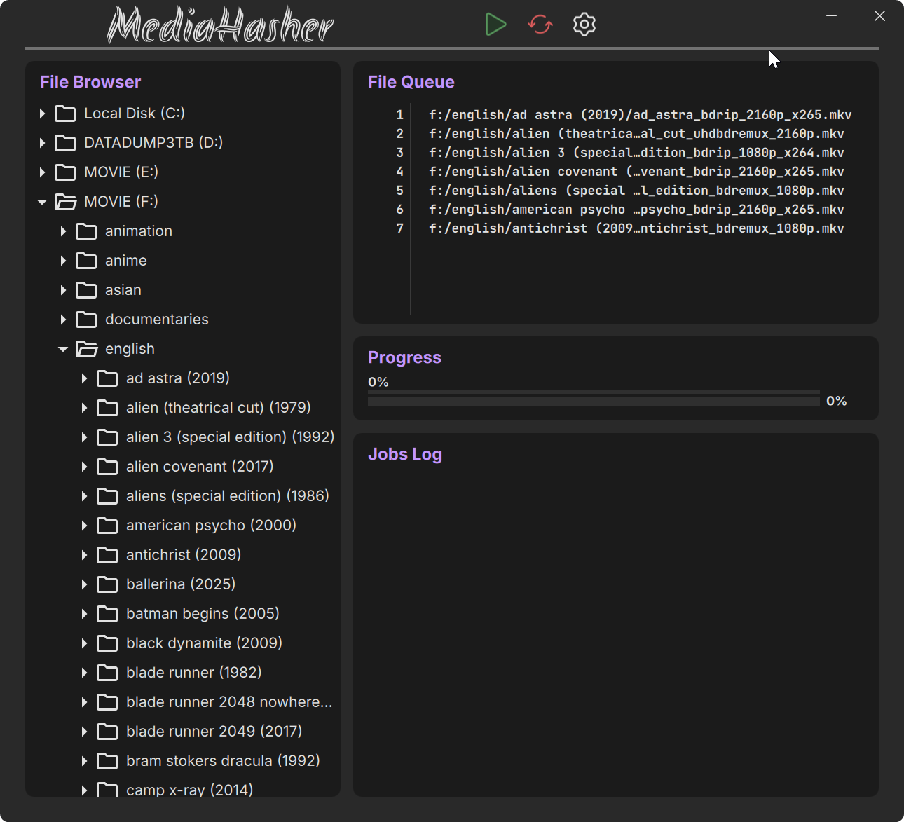

# MediaHasher

A cross-platform desktop tool for computing and verifying media file
integrity, built with Qt 6 / QML on top of a Qt-free C++20 hashing core.



## Project layout

- **`MediaHash/`**: the core library (`MediaHash`), a small command-line
  front-end (`mediahash`), and unit tests. Qt-free; depends only on OpenSSL,
  BLAKE3, and xxHash. Builds standalone.
- **`ui/`**: the Qt 6 / QML desktop application (`MediaHasher`), which links
  the core library.

There is no top-level `CMakeLists.txt`: these are two independent CMake
projects, and `ui/` pulls the core in with `add_subdirectory(../MediaHash)`.
Building the application therefore builds the core library and the CLI as
well.

## Usage

Files are added to the hashing queue by drag and drop. There are two ways to
do it, and they can be mixed freely:

**From the built-in file browser.** Use the file tree on the left to navigate
your filesystem. Select one or more media files (multi-selection is
supported) and drag them onto the queue. The browser only lists supported
media files, so anything you can see there can be queued.

**From your system file manager.** Drag files straight from Finder, Windows
File Explorer, or your Linux file manager onto the queue. Dropping a
**folder** works too: MediaHasher walks it recursively and picks up every
supported media file inside it, including in subfolders.

Either way, files already in the queue are not added twice, and the resulting
list is sorted by path. Once a run has completed, the queue stops accepting
drops. Start a new run to queue more files.

## Companion files

For every file it hashes, MediaHasher writes a small companion file next to
the original, in the same directory. The companion takes the name of the
source file with its extension **replaced** by the algorithm used, so hashing
`movie.mkv` with the default algorithm produces `movie.blake3`:

| Algorithm | Digest | Companion file |
|-----------|--------|----------------|
| BLAKE3 (default) | 256-bit | `movie.blake3` |
| XXH3 | 64-bit | `movie.xxh3` |
| XXH3 | 128-bit | `movie.xxh128` |
| SHA-256 | 256-bit | `movie.sha256` |
| SHA-1 (legacy) | 160-bit | `movie.sha1` |

Hashing the same file with more than one algorithm therefore leaves several
companions side by side, and MediaHasher uses their presence to work out which
algorithms a file has already been hashed with. SHA-1 is kept only so that
companion files written by earlier versions stay verifiable.

The format is two lines of plain text, written as UTF-8 on every platform so
the files are byte-identical no matter which operating system produced them:

```
File name : movie.mkv
BLAKE3 hash : af1349b9f5f9a1a6a0404dea36dcc9499bcb25c9adc112b7cc9a93cae41f3262
```

## Supported file types

MediaHasher is currently limited to **Matroska (`.mkv`)** files. Nothing in
the hashing core is format-specific, since it hashes arbitrary bytes, so this is
purely a front-end restriction, and widening it is mostly a matter of
extending the extension list.

At present that list is hardcoded in two places in `ui/`:

- `main.cpp`: the `FileExtensionFilterProxyModel` constructed with
  `{".mkv"}`, which controls what the in-app file browser displays.
- `FileHelper::resolveMkvFiles()`: filters files dropped from the
  system file manager and drives the recursive folder walk.

### Planned

- A settings option to manage this list from within the application, so
  extensions can be added manually without a rebuild.

## Prerequisites

- CMake 4.1 or newer
- A C++20 compiler
- Qt 6 (Core, Gui, Quick, QuickControls2)

### macOS

Dependencies come from Homebrew:

```sh
brew install qt openssl@3 blake3 xxhash yaml-cpp
```

### Windows

Install Qt with the [Qt online installer](https://www.qt.io/download-qt-installer)
(an `msvc*_64` kit) and Visual Studio with the C++ workload. The remaining
dependencies are resolved by [Conan](https://conan.io/):

```powershell
pip install conan
```

The required packages are declared in `MediaHash/conanfile.txt` and
`ui/conanfile.txt`; nothing needs installing by hand.

## Building

Both platforms have a build driver that wraps the CMake invocations. Run them
from the repository root.

### macOS and Linux

```sh
make                    # build the application (Debug)
make -j6                # ...with six parallel jobs
make run                # build, then run with logging on the terminal
make test               # build the core standalone and run its unit tests
make BUILD_TYPE=Release # release build
make help               # all targets and resolved settings
```

Qt and OpenSSL are located through Homebrew automatically. Override either if
needed:

```sh
make QT_PREFIX="$(brew --prefix qt)"
make QT_PREFIX=$HOME/Qt/6.11.1/macos
```

Output lands in `build/app-debug/` or `build/app-release/`.

### Windows

```powershell
.\scripts\build.ps1                          # build the application (Debug)
.\scripts\build.ps1 -Jobs 6
.\scripts\build.ps1 run
.\scripts\build.ps1 test
.\scripts\build.ps1 -BuildType Release
.\scripts\build.ps1 help
```

The script runs `conan install`, configures CMake with the generated
toolchain, and builds. Qt is auto-detected under `C:\Qt` and `%USERPROFILE%\Qt`,
or set it explicitly:

```powershell
.\scripts\build.ps1 -QtPrefix C:\Qt\6.11.1\msvc2022_64
```

Output lands in `build\win-debug\` or `build\win-release\`.

> PowerShell blocks unsigned scripts by default. Either run
> `powershell -ExecutionPolicy Bypass -File .\scripts\build.ps1`, or allow
> local scripts once with
> `Set-ExecutionPolicy -Scope CurrentUser RemoteSigned`.

### CLion

Open the **`ui/`** directory as the project. Because the core is added with an
explicit binary directory, the Project panel shows both `ui` and `MediaHash`
as roots and builds them together.

If CMake cannot find Qt, add its prefix under **Settings → Build, Execution,
Deployment → CMake → CMake options**:

```
-DCMAKE_PREFIX_PATH=/opt/homebrew/opt/qt          # macOS
-DCMAKE_PREFIX_PATH=C:/Qt/6.11.1/msvc2022_64      # Windows
```

To work on the core library and run its tests, open `MediaHash/` as a separate
project. Its unit tests are built only when it is the top-level project
(`MEDIAHASH_BUILD_TESTS` defaults to `PROJECT_IS_TOP_LEVEL`).

### Plain CMake

The build drivers are conveniences, not requirements:

```sh
# macOS: application (builds the core too)
cmake -S ui -B build/app \
      -DCMAKE_BUILD_TYPE=Release \
      -DCMAKE_PREFIX_PATH="$(brew --prefix qt)"
cmake --build build/app

# Core library, CLI and unit tests, standalone
cmake -S MediaHash -B build/core -DCMAKE_BUILD_TYPE=Release
cmake --build build/core
ctest --test-dir build/core
```

On Windows, run `conan install ui --output-folder=build/win --build=missing`
first and pass the generated toolchain. Note that `CMAKE_TOOLCHAIN_FILE` must
be an **absolute path with forward slashes**, because CMake resolves a relative
toolchain path against the build directory, not the working directory.

### Build notes

- Debug builds compile with `-Wall -Wextra -Wpedantic -Werror` on
  GCC/Clang/AppleClang, so warnings fail the build.
- On Windows, Debug builds link against the console subsystem so Qt logging
  reaches stderr; Release builds are GUI subsystem.
- The `mediahash` CLI is placed beside the application: next to the executable
  on Windows, inside `MediaHasher.app/Contents/MacOS` on macOS.

## Packaging

### macOS

```sh
make BUILD_TYPE=Release bundle   # self-contained .app
make BUILD_TYPE=Release dmg      # ...and a .dmg
make BUILD_TYPE=Release install  # copy to /Applications
```

`scripts/macdeploy.sh` runs `macdeployqt`, drops plugins the application never
loads (SQL drivers and the unused Qt Quick Controls styles), re-signs the
bundle ad-hoc, and then reports any library still resolving outside the
bundle. Read that final report: anything listed would be missing on another
machine.

### Windows

```powershell
.\scripts\build.ps1 dist -BuildType Release   # stage dist\MediaHasher\
.\scripts\build.ps1 zip  -BuildType Release   # ...and compress it
```

`windeployqt` runs automatically as a post-build step, so the staged folder
already contains the Qt runtime.

### Opening an unsigned macOS build

Distributed builds are signed **ad-hoc** rather than with an Apple Developer
ID, and they are not notarized. macOS will refuse to open such an app
downloaded from the internet, usually reporting that it is *damaged and can't
be opened*.

The app is not damaged. That is Gatekeeper's response to an unrecognized
signature on a quarantined file. Either:

- Right-click (or Control-click) the app, choose **Open**, and confirm. This
  is only needed once.
- Or clear the quarantine attribute:

  ```sh
  xattr -dr com.apple.quarantine /Applications/MediaHasher.app
  ```

Signing with a Developer ID and notarizing removes this step entirely. It
requires a paid Apple Developer account and is not currently done.

## Licensing

This project is dual-structured:

- The **MediaHasher application** as a whole is licensed under the
  **GNU General Public License v3.0** (`LICENSE`). This is required because
  the application links Qt.
- The **MediaHash core library** (`MediaHash/`), taken on its own, is licensed
  under the **MIT License** (`MediaHash/LICENSE`), so it can be reused in
  other projects without copyleft obligations.

Third-party components bundled with or linked by the project are listed in
[`THIRD-PARTY-NOTICES.md`](THIRD-PARTY-NOTICES.md).
